## ❯ Connect with me

## ❯ About me

- 🎓 **1st Class Software Engineering graduate**
- 👨‍💻 **Aspiring developer**, building projects and sharpening my skills as I go
- 🖥️ **Computer enthusiast**, always curious how things work under the hood
- 🎨 Designing in **Figma** and planning in **Trello**
- 🎯 Next on my list: **React, C#, C++, Unreal Engine, Java & Lua**
- 📫 Want to talk code? Reach me at [xleo.dev@gmail.com](mailto:xleo.dev@gmail.com)

## ❯ Tech stack

**Languages & databases**

**Tools**

**Up next**

## ❯ GitHub stats

<picture>
  <source media="(prefers-color-scheme: dark)" srcset="https://raw.githubusercontent.com/Leoelo4/Leoelo4/output/github-snake-dark.svg" />
  <source media="(prefers-color-scheme: light)" srcset="https://raw.githubusercontent.com/Leoelo4/Leoelo4/output/github-snake.svg" />
  
</picture>

